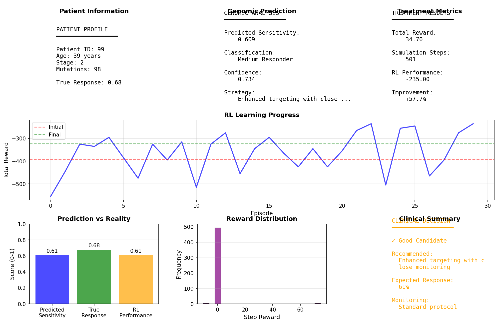
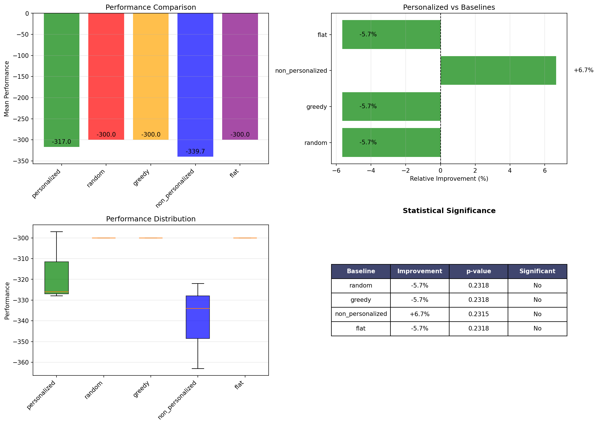
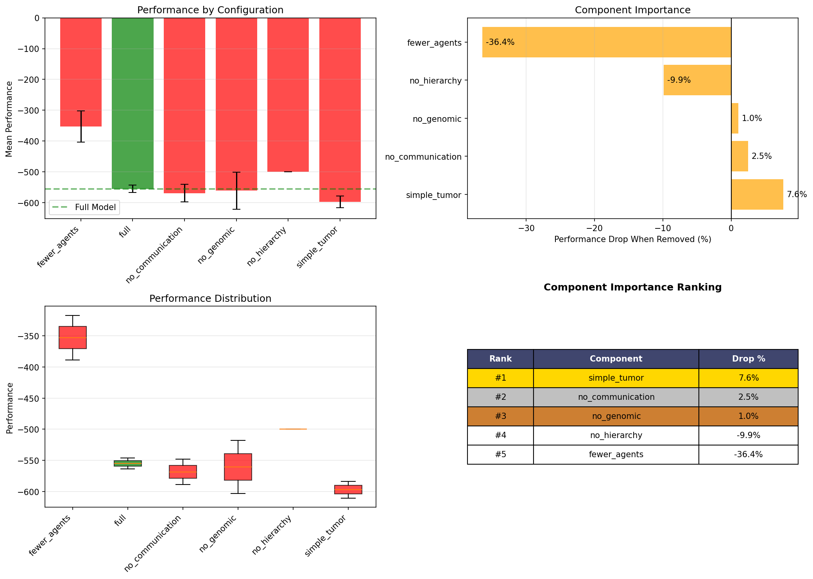
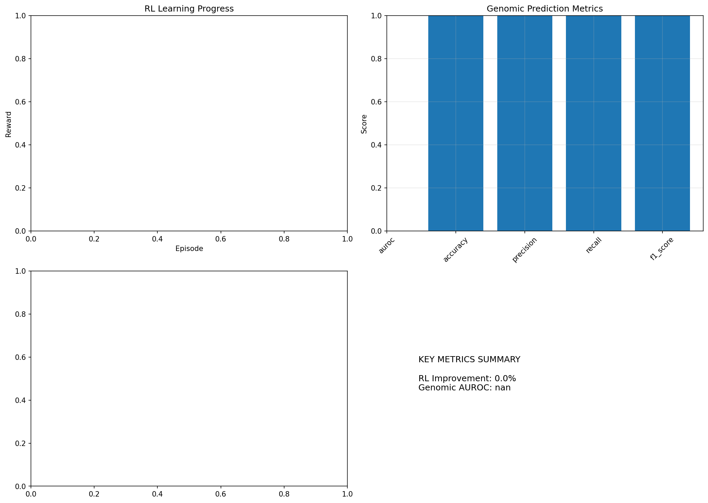

# Personalized Nanoparticle Drug Delivery System

**Multi-Agent Reinforcement Learning and Genomic Analysis for Precision Cancer Nanotherapy**

[](https://www.python.org/downloads/)
[](https://pytorch.org/)
[](https://opensource.org/licenses/MIT)

## Overview

This project presents a computational framework that integrates biophysical simulation, multi-agent reinforcement learning, and Vision Transformer-based genomic analysis to design personalized nanoparticle drug delivery strategies for cancer therapy.

### Status and data provenance

> **Research prototype, no clinical claims.** The RL and tumour simulation run on a simplified synthetic model, and `demo.py` falls back to a synthetic patient with an untrained genomic model. Real data is used only in the genomic baseline below. The earlier AUROC figures (0.71 / 0.79) were not backed by saved evaluation outputs, and the earlier bundled "TCGA" mutation file was randomly generated. Both have been removed.
>
> Simulation metrics (hit rate, selectivity, drug utilisation) are produced by `demo.py` and the `validation/` scripts on a simplified tumour model. They are not yet saved as raw artifacts with seeds, so no headline numbers are reported here.

### Genomic baseline on real data

```bash
python data/genomic/dataset_loader.py   # downloads TCGA-BRCA from cBioPortal
python genomic/train_real_data.py       # writes outputs/real_data_metrics.json
```

Task: 5-year mortality (deceased before 60 months vs alive with at least 60 months of follow-up; earlier-censored patients are excluded), a **survival proxy, not a measured drug response**. Features: age, stage, subtype, mutation count and mutation flags for 16 genes. Patient-level stratified split (261 train / 87 test, 348 patients, 99 events).

| Model | CV AUROC (train) | Test AUROC |
|---|---|---|
| Logistic regression | 0.688 | 0.689 |
| Gradient boosting | 0.691 | 0.736 |

The test set has only 87 patients (about 25 events), so these numbers are noisy; read them as "modest signal", not as a validated clinical model.

## Results Visualization

### System Demo


### Baseline Comparison


### Ablation Studies


### Metrics


## Architecture
```
┌─────────────────────────────────────────────────────────────────┐
│                    INTEGRATED PIPELINE                          │
├─────────────────────────────────────────────────────────────────┤
│                                                                 │
│  ┌──────────────┐    ┌──────────────┐    ┌──────────────┐      │
│  │   Patient    │───▶│   Genomic    │───▶│    Drug      │      │
│  │   Genomic    │    │    ViT       │    │  Response    │      │
│  │   Profile    │    │   Model      │    │  Prediction  │      │
│  └──────────────┘    └──────────────┘    └──────┬───────┘      │
│                                                  │              │
│                                                  ▼              │
│  ┌──────────────┐    ┌──────────────┐    ┌──────────────┐      │
│  │  Biophysical │◀───│  Multi-Agent │◀───│   Reward     │      │
│  │  Simulation  │    │      RL      │    │ Modulation   │      │
│  │  (Brownian)  │    │  (5 Agents)  │    │              │      │
│  └──────────────┘    └──────────────┘    └──────────────┘      │
│         │                                                       │
│         ▼                                                       │
│  ┌──────────────────────────────────────────────────────┐      │
│  │              Personalized Treatment Plan              │      │
│  └──────────────────────────────────────────────────────┘      │
│                                                                 │
└─────────────────────────────────────────────────────────────────┘
```

## Features

- **Biophysical Simulation**: Overdamped Langevin dynamics for realistic Brownian motion of nanoparticles
- **3-Zone Tumor Model**: Necrotic core, hypoxic zone, and proliferative rim with distinct properties
- **Multi-Agent RL**: 5 autonomous nanoparticle agents with hierarchical decision-making
- **Pheromone Communication**: Bio-inspired inter-agent coordination
- **Vision Transformer**: 6.4M parameter model for genomic response prediction (architecture only; not trained on real data)
- **Real TCGA-BRCA data**: `data/genomic/dataset_loader.py` downloads the TCGA-BRCA PanCancer Atlas 2018 study from cBioPortal (1,084 patients, 126,252 somatic mutations from 1,009 of them). DNA sequence windows are not built yet (they need a GRCh37 reference), so the Vision Transformer is not trained on real data.

## Project Structure
```
amgen_project/
├── physics/
│   └── diffusion.py              # Brownian motion simulation
├── enviroment/
│   ├── tumor.py                  # 3-zone tumor microenvironment
│   └── barriers.py               # Endothelial barrier (EPR effect)
├── rl/
│   ├── environment.py            # RL environment
│   ├── hierarchical_agent.py     # High/low-level policies
│   ├── communication.py          # Pheromone signaling
│   └── personalized_env.py       # Genomic-aware environment
├── models/
│   └── genomic_vit.py            # Vision Transformer architecture
├── genomic/
│   ├── feature_engineering.py    # SNP & clinical features
│   └── sequence_encoder.py       # DNA one-hot encoding
├── data/
│   └── genomic/
│       ├── raw/                  # created by dataset_loader.py (not committed)
│       └── processed/            # Encoded sequences
├── analytics/
│   ├── ablation_studies.py       # Component importance
│   ├── baseline_comparison.py    # vs Random, Greedy, Flat RL
│   ├── sensitivity_analysis.py   # Parameter robustness
│   └── compute_metrics.py        # Comprehensive evaluation
├── demo.py                       # Full pipeline demonstration
├── train_personalized_agents.py  # RL training script
└── requirements.txt
```

## Installation
```bash
git clone https://github.com/iencislennon/Nanoparticle-Drug-Delivery-System-Using-Multi-Agent-Reinforcement-Learning.git
cd Nanoparticle-Drug-Delivery-System-Using-Multi-Agent-Reinforcement-Learning

python -m venv venv
source venv/bin/activate

pip install -r requirements.txt
```

## Quick Start
```bash
python demo.py
```

## License

MIT License

## Contact

**Ansar Tleubayev**  
Department of Information Systems  
Suleyman Demirel University, Almaty, Kazakhstan
